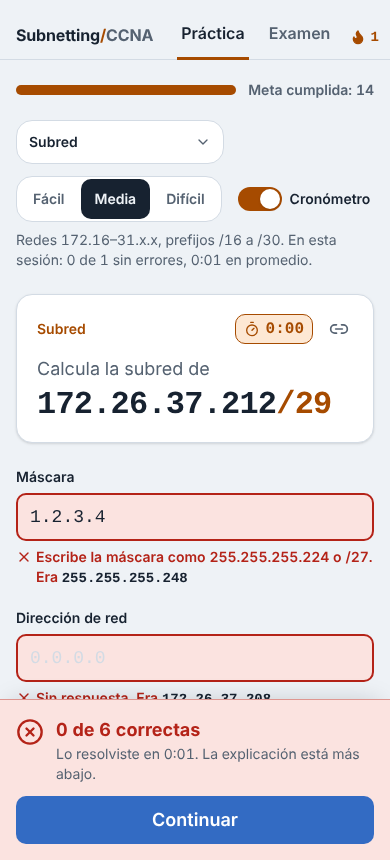
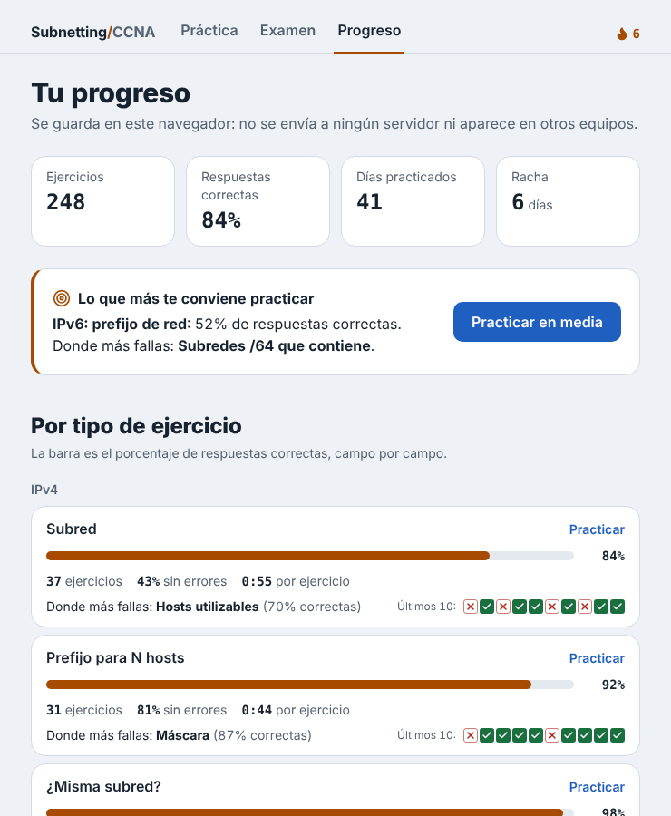
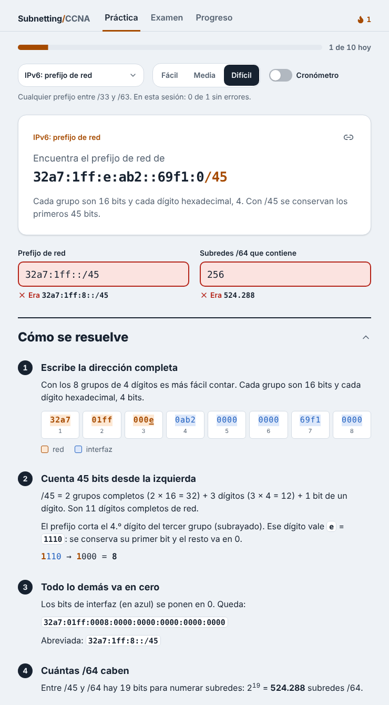

# Entrenador de subnetting

[](https://github.com/gadiiiiii/subnetting-trainer/actions/workflows/ci.yml)

Práctica de subnetting IPv4 e IPv6 para el **CCNA 200-301**, en español. La app te da un ejercicio, tú escribes la respuesta y te corrige **explicando el paso a paso**: la red en binario, el tamaño de bloque y de dónde sale cada número.

<p>
  
  
</p>

## Qué hace

### Ocho tipos de ejercicio

**IPv4**

| Tipo | Qué se pide | Explicación |
|---|---|---|
| **Subred** | Dada `172.26.37.212/29`: máscara, red, broadcast, primer y último host, hosts utilizables | Binario con bits de red y host coloreados, tamaño de bloque y rango |
| **Prefijo para N hosts** | "Necesitas 50 hosts": prefijo, máscara y hosts utilizables | Tabla con el intento que no alcanza y el que sí (2<sup>h</sup> − 2) |
| **¿Misma subred?** | Dos direcciones con el mismo prefijo: red de cada una y si se comunican sin router | La mitad de las veces la segunda cae en la subred vecina, cerca del límite |
| **Wildcard** | De la red a la wildcard o al revés, en el contexto de una ACL o de OSPF | Máscara invertida en binario, resta 255 − octeto y el comando del router |
| **Binario** | Un octeto de decimal a binario o al revés | Tabla de pesos 128…1 y la resta paso a paso |

**IPv6**

| Tipo | Qué se pide | Explicación |
|---|---|---|
| **Abreviar y expandir** | Pasar `2001:0db8:0000:0000:0000:ff00:0042:8329` a `2001:db8::ff00:42:8329` o al revés | Los 8 grupos, los ceros a la izquierda y cuál secuencia de ceros se reemplaza por `::` (la más larga; si empatan, la primera) |
| **Prefijo de red** | Dada `2001:db8:acad:1234::25/52`: prefijo de red y cuántas subredes /64 contiene (o la interfaz, si es /64) | Dónde corta el prefijo, el dígito partido en binario y 2<sup>64 − p</sup> |
| **EUI-64** | Con un prefijo /64 y una MAC: el ID de interfaz y la dirección completa | MAC partida en dos, `FFFE` al medio y el 7.º bit invertido |

Cada tipo tiene tres dificultades. En IPv4, fácil usa redes `192.168.x.x` y prefijos desde /24; difícil, cualquier red unicast y prefijos desde /8. En IPv6, fácil usa /64 y el bloque de documentación `2001:db8::/32`; difícil, prefijos que cortan un dígito por la mitad y direcciones con dos secuencias de ceros.

Las abreviaturas IPv6 se corrigen según la RFC 5952: si escribes la misma dirección pero no en su forma más corta, la app te lo dice en vez de marcarla como incorrecta.

### Formato de lección

Una pregunta a la vez. Respondes y una **franja inferior** confirma («Todo correcto», en verde) o corrige («3 de 6 correctas», en rojo) antes de pasar al siguiente. La explicación queda debajo: se abre sola cuando hubo errores. Arriba hay una **meta diaria** de 10 ejercicios y una **racha** de días seguidos practicando, guardadas en el navegador.

### Modalidades

- **Práctica:** un ejercicio a la vez, con corrección inmediata y la explicación debajo. Un **cronómetro** opcional muestra cuánto tardas en cada ejercicio y el promedio de la sesión.
- **Mixto:** cada ejercicio es de un tipo al azar. Hay tres mezclas: solo IPv4, solo IPv6 o todo.
- **Examen:** 10 ejercicios con el reloj corriendo. Las correcciones y explicaciones aparecen recién al final, en una revisión ejercicio por ejercicio. En las mezclas los tipos se reparten parejo (en Mixto IPv4, dos de cada uno). Guarda tu mejor resultado (porcentaje y tiempo) para cada configuración.

### Progreso por tipo de ejercicio

La página **Progreso** junta todo lo que practicaste y los exámenes que diste:

- Porcentaje de respuestas correctas por tipo, ejercicios sin errores, tiempo promedio (si usas el cronómetro) y los últimos 10 resultados.
- El campo donde más fallas en cada tipo (por ejemplo, el broadcast en Subred) y un **punto débil** con un botón para practicarlo.
- Un calendario de las últimas 12 semanas con los días que practicaste.

Se guarda solo en el navegador. Ver la solución cuenta como ejercicio no resuelto, pero no baja el porcentaje.



### Ejercicios y exámenes compartibles

Todo sale de una semilla que queda en la URL: `?t=mixto&n=media&s=k7m2qx`. Quien abra el enlace ve el mismo ejercicio o el mismo examen, así que sirve para competir con alguien o para que un profesor le dé el mismo examen a todo el curso.

### Corrección

Corrige campo por campo y distingue respuestas incorrectas, vacías o mal escritas. Acepta formatos equivalentes: la máscara como `255.255.255.248` o `/29`, ceros a la izquierda, hosts con separador de miles, binario con o sin espacios y "si" sin tilde.




## Cómo está hecho

- [Next.js](https://nextjs.org) + TypeScript, sin backend ni base de datos.
- [Tailwind CSS v4](https://tailwindcss.com) y componentes con la estructura de [shadcn/ui](https://ui.shadcn.com) (Radix UI): Select, ToggleGroup, Switch, Progress, Accordion y avisos con Sonner. Íconos de [Lucide](https://lucide.dev). El `components.json` está configurado para agregar más con `npx shadcn add`.
- **Sistema de diseño** documentado en [`DESIGN.md`](DESIGN.md): colores con su rol (naranjo y azul del cable T568B), tipografía, espaciado y componentes. Los tokens viven en `app/globals.css` y las pantallas los usan por nombre.
- **Accesibilidad:** auditada con axe-core (WCAG 2.1 AA, modo claro y oscuro, sin infracciones), navegable con teclado, contraste mínimo 4,5:1 y respeta `prefers-reduced-motion`.
- La lógica está separada de la interfaz, en `lib/`:
  - [`lib/ipv4.ts`](lib/ipv4.ts): direcciones como enteros de 32 bits, máscaras, wildcards, red, broadcast y hosts.
  - [`lib/ipv6.ts`](lib/ipv6.ts): direcciones como `BigInt` de 128 bits, lectura con `::`, abreviación RFC 5952, prefijos y EUI-64.
  - [`lib/ejercicio.ts`](lib/ejercicio.ts): lo común a todos los ejercicios (campos, corrección y lectura de respuestas).
  - Un archivo por tipo: [`basico.ts`](lib/basico.ts), [`hosts.ts`](lib/hosts.ts), [`misma.ts`](lib/misma.ts), [`wildcard.ts`](lib/wildcard.ts), [`binario.ts`](lib/binario.ts), [`abreviar6.ts`](lib/abreviar6.ts), [`prefijo6.ts`](lib/prefijo6.ts) y [`eui64.ts`](lib/eui64.ts). Cada uno genera el ejercicio, lo corrige y calcula los datos de su explicación.
  - [`lib/tipos.ts`](lib/tipos.ts): registro de tipos y modo mixto. [`lib/examen.ts`](lib/examen.ts): armado y resumen del examen.
  - [`lib/azar.ts`](lib/azar.ts): números pseudoaleatorios reproducibles a partir de una semilla (FNV-1a + mulberry32).
  - [`lib/progreso.ts`](lib/progreso.ts): racha de días y meta diaria. [`lib/estadisticas.ts`](lib/estadisticas.ts): progreso por tipo, punto débil y calendario.
- **Tests con [Vitest](https://vitest.dev).** Los cálculos de `ipv4.ts` se comparan contra una implementación de referencia que trabaja con cadenas de bits, en 20.000 casos al azar más los extremos (`0.0.0.0`, `255.255.255.255`, /0, /32). La abreviación IPv6 se compara con la normalización de URLs de Node en 20.000 direcciones al azar. Para cada tipo y dificultad se generan cientos de ejercicios y se verifica que su propia solución se corrija como correcta. Así la app nunca enseña una respuesta incorrecta.
- GitHub Actions corre los tests y el build en cada push.

## Desarrollo local

```bash
npm install
npm run dev      # http://localhost:3000
npm test
npm run build
```

## Hoja de ruta

- [x] **Fase 1:** ejercicio básico con explicación, semilla en la URL, tests y CI.
- [x] **Fase 2:** prefijo para N hosts, ¿misma subred?, wildcards y binario; modo mixto, cronómetro y modo examen.
- [ ] **Fase 3:** VLSM, asignar subredes a varios departamentos desde un bloque.
- [x] **Rediseño:** formato de lección, Tailwind + shadcn/ui, racha y meta diaria, DESIGN.md.
- [x] **Fase 4:** progreso por tipo de ejercicio e IPv6 (abreviación, prefijos /64 y EUI-64).

## Licencia

MIT — Gadiel Vega Salgado
