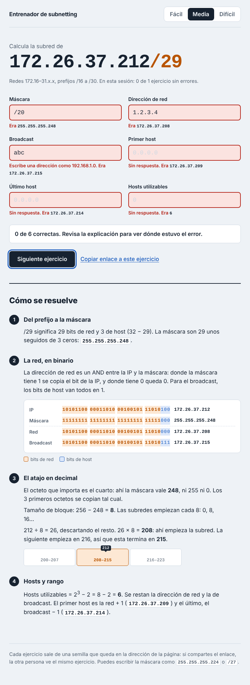

# Entrenador de subnetting

[](https://github.com/gadiiiiii/subnetting-trainer/actions/workflows/ci.yml)

Práctica de subnetting IPv4 para el **CCNA 200-301**. La app te da una dirección con prefijo, tú escribes la respuesta y te corrige **explicando el paso a paso**: la red en binario, el tamaño de bloque y de dónde sale cada número.



## Qué hace

- **Ejercicio básico:** dada una dirección como `172.26.37.212/29`, calcular máscara, dirección de red, broadcast, primer y último host, y hosts utilizables.
- **Tres dificultades:**
  - Fácil: redes `192.168.x.x`, prefijos /24 a /30.
  - Media: redes `172.16–31.x.x`, prefijos /16 a /30.
  - Difícil: cualquier red unicast, prefijos /8 a /30.
- **Corrección campo por campo.** Distingue respuestas incorrectas, vacías o mal escritas, y acepta formatos equivalentes: la máscara como `255.255.255.248` o `/29`, ceros a la izquierda en las direcciones y hosts con separador de miles.
- **Explicación en cuatro pasos:**
  1. Del prefijo a la máscara.
  2. La red y el broadcast en binario, con los bits de red y de host coloreados.
  3. El atajo decimal del tamaño de bloque, el que conviene usar en el examen.
  4. Cantidad de hosts y rango utilizable.
- **Ejercicios compartibles.** Cada ejercicio sale de una semilla que queda en la URL (`?n=media&s=k7m2qx`): quien abra el enlace ve el mismo ejercicio.
- Funciona con teclado: Enter revisa, y Enter otra vez pasa al siguiente ejercicio.

## Cómo está hecho

- [Next.js](https://nextjs.org) + TypeScript, sin backend ni base de datos.
- La lógica está separada de la interfaz, en `lib/`:
  - [`lib/ipv4.ts`](lib/ipv4.ts): direcciones como enteros de 32 bits, máscaras, wildcards, red, broadcast y hosts.
  - [`lib/basico.ts`](lib/basico.ts): generación del ejercicio, corrección y datos de la explicación.
  - [`lib/azar.ts`](lib/azar.ts): números pseudoaleatorios reproducibles a partir de una semilla (FNV-1a + mulberry32).
- **Tests con [Vitest](https://vitest.dev).** Los cálculos de `ipv4.ts` se comparan contra una implementación de referencia que trabaja con cadenas de bits, en 20.000 casos al azar más los extremos (`0.0.0.0`, `255.255.255.255`, /0, /32). Así la app nunca enseña una respuesta incorrecta.
- GitHub Actions corre los tests y el build en cada push.

## Desarrollo local

```bash
npm install
npm run dev      # http://localhost:3000
npm test
npm run build
```

## Hoja de ruta

- [x] **Fase 1:** ejercicio básico con explicación, semilla en la URL, tests y CI.
- [ ] **Fase 2:** prefijo para N hosts, ¿misma subred? y wildcards (ACL y OSPF).
- [ ] **Fase 3:** VLSM, asignar subredes a varios departamentos desde un bloque.
- [ ] **Fase 4:** progreso por tipo de ejercicio, modo examen con cronómetro e IPv6 (abreviación, prefijos /64 y EUI-64).

## Licencia

MIT — Gadiel Vega Salgado
