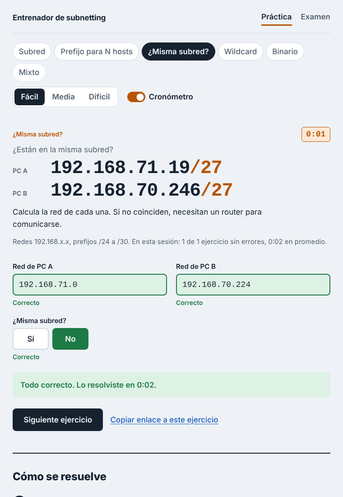
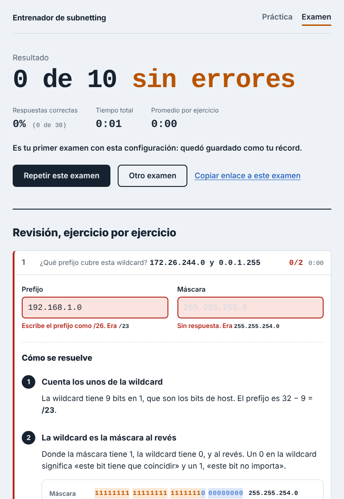

# Entrenador de subnetting

[](https://github.com/gadiiiiii/subnetting-trainer/actions/workflows/ci.yml)

Práctica de subnetting IPv4 para el **CCNA 200-301**, en español. La app te da un ejercicio, tú escribes la respuesta y te corrige **explicando el paso a paso**: la red en binario, el tamaño de bloque y de dónde sale cada número.


## Qué hace

### Cinco tipos de ejercicio

| Tipo | Qué se pide | Explicación |
|---|---|---|
| **Subred** | Dada `172.26.37.212/29`: máscara, red, broadcast, primer y último host, hosts utilizables | Binario con bits de red y host coloreados, tamaño de bloque y rango |
| **Prefijo para N hosts** | "Necesitas 50 hosts": prefijo, máscara y hosts utilizables | Tabla con el intento que no alcanza y el que sí (2<sup>h</sup> − 2) |
| **¿Misma subred?** | Dos direcciones con el mismo prefijo: red de cada una y si se comunican sin router | La mitad de las veces la segunda cae en la subred vecina, cerca del límite |
| **Wildcard** | De la red a la wildcard o al revés, en el contexto de una ACL o de OSPF | Máscara invertida en binario, resta 255 − octeto y el comando del router |
| **Binario** | Un octeto de decimal a binario o al revés | Tabla de pesos 128…1 y la resta paso a paso |

Cada tipo tiene tres dificultades. En fácil se usan redes `192.168.x.x` y prefijos desde /24; en difícil, cualquier red unicast y prefijos desde /8.

### Modalidades

- **Práctica:** un ejercicio a la vez, con corrección inmediata y la explicación debajo. Un **cronómetro** opcional muestra cuánto tardas en cada ejercicio y el promedio de la sesión.
- **Mixto:** cada ejercicio es de un tipo al azar.
- **Examen:** 10 ejercicios con el reloj corriendo. Las correcciones y explicaciones aparecen recién al final, en una revisión ejercicio por ejercicio. En mixto trae dos ejercicios de cada tipo. Guarda tu mejor resultado (porcentaje y tiempo) para cada configuración.

### Ejercicios y exámenes compartibles

Todo sale de una semilla que queda en la URL: `?t=mixto&n=media&s=k7m2qx`. Quien abra el enlace ve el mismo ejercicio o el mismo examen, así que sirve para competir con alguien o para que un profesor le dé el mismo examen a todo el curso.

### Corrección

Corrige campo por campo y distingue respuestas incorrectas, vacías o mal escritas. Acepta formatos equivalentes: la máscara como `255.255.255.248` o `/29`, ceros a la izquierda, hosts con separador de miles, binario con o sin espacios y "si" sin tilde.





## Cómo está hecho

- [Next.js](https://nextjs.org) + TypeScript, sin backend ni base de datos.
- La lógica está separada de la interfaz, en `lib/`:
  - [`lib/ipv4.ts`](lib/ipv4.ts): direcciones como enteros de 32 bits, máscaras, wildcards, red, broadcast y hosts.
  - [`lib/ejercicio.ts`](lib/ejercicio.ts): lo común a todos los ejercicios (campos, corrección y lectura de respuestas).
  - Un archivo por tipo: [`basico.ts`](lib/basico.ts), [`hosts.ts`](lib/hosts.ts), [`misma.ts`](lib/misma.ts), [`wildcard.ts`](lib/wildcard.ts) y [`binario.ts`](lib/binario.ts). Cada uno genera el ejercicio, lo corrige y calcula los datos de su explicación.
  - [`lib/tipos.ts`](lib/tipos.ts): registro de tipos y modo mixto. [`lib/examen.ts`](lib/examen.ts): armado y resumen del examen.
  - [`lib/azar.ts`](lib/azar.ts): números pseudoaleatorios reproducibles a partir de una semilla (FNV-1a + mulberry32).
- **Tests con [Vitest](https://vitest.dev).** Los cálculos de `ipv4.ts` se comparan contra una implementación de referencia que trabaja con cadenas de bits, en 20.000 casos al azar más los extremos (`0.0.0.0`, `255.255.255.255`, /0, /32). Para cada tipo y dificultad se generan cientos de ejercicios y se verifica que su propia solución se corrija como correcta. Así la app nunca enseña una respuesta incorrecta.
- GitHub Actions corre los tests y el build en cada push.

## Desarrollo local

```bash
npm install
npm run dev      # http://localhost:3000
npm test
npm run build
```

## Hoja de ruta

- [x] **Fase 1:** ejercicio básico con explicación, semilla en la URL, tests y CI.
- [x] **Fase 2:** prefijo para N hosts, ¿misma subred?, wildcards y binario; modo mixto, cronómetro y modo examen.
- [ ] **Fase 3:** VLSM, asignar subredes a varios departamentos desde un bloque.
- [ ] **Fase 4:** progreso por tipo de ejercicio e IPv6 (abreviación, prefijos /64 y EUI-64).

## Licencia

MIT — Gadiel Vega Salgado
